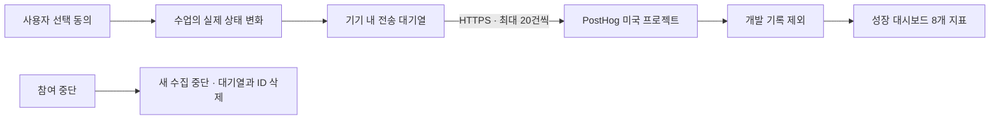

# 서당 성장 데이터 운영 안내

대시보드: https://us.posthog.com/project/650471/dashboard/2180325

2026-10-16 기준: 파이프라인 구현 및 개발 이벤트 수신 검증 완료. 실제 사용자 수집은 아직 시작하지 않았습니다. 1.1.2(iOS 37/Android 21)에 분석 기능을 포함해 심사 제출했고 공개 방침과 스토어 개인정보 항목도 변경했습니다. 실제 공개 출시는 아직 확인되지 않았습니다. 대시보드의 0은 출시 전 실사용 성과가 아닙니다.

## 처음에는 매주 10분만 보세요

1. **02 최근 7일 학습 기기**: 지난주 같은 요일보다 늘었는지 확인합니다. 하루만 보지 말고 2~4주 흐름을 봅니다.
2. **04 첫 수업 완료**: 통계 참여 → 시작 → 완료 중 어디에서 줄어드는지 확인합니다. 시작이 적으면 진입 화면을, 완료가 적으면 첫 수업 길이와 난이도를 살펴봅니다.
3. **05 재방문**: Day 1은 다음 날, Day 7은 정확히 7일 뒤에 다시 공부한 비율입니다. Day 7은 일주일이 지나야 읽을 수 있습니다. 작은 표본의 큰 변화는 결론을 미룹니다.
4. **06·07 언어와 난이도**: 어느 과정을 먼저 개선할지 참고합니다. 참여가 적다는 것만으로 수업이 어렵다고 단정하지 않습니다.
5. 한 주에 바꿀 점 하나를 정하고 변경 날짜를 적습니다. 다음 주에는 같은 요일·같은 관측 기간을 비교합니다.

다운로드 수는 App Store Connect와 Play Console에서 확인합니다. 이 대시보드는 통계 공유에 동의한 설치만 보여줍니다. **참여율·설치 대비 활성화율·동의 전 온보딩 이탈·매출은 현재 측정하지 않습니다.** 같은 사람이 두 기기를 쓰면 두 설치이며, 재설치·데이터 삭제·재동의로 ID가 바뀔 수 있습니다. 배포 직후 기존 사용자의 동의를 신규 설치로 해석하지 마세요.

## 데이터가 이동하는 길

별도 DB나 ETL 서버를 운영하지 않습니다. 앱이 공개 수집용 토큰으로 PostHog `/batch/`에 직접 전송하고 PostHog가 보관·집계합니다. 개인 API 키·관리 권한은 앱에 넣지 않습니다. 자동 클릭 수집 SDK, 세션 재생, 개인 프로필 생성, 광고 추적은 사용하지 않습니다.

- 수집 전: 기본 미동의. 설치 ID를 만들거나 이벤트를 저장·전송하지 않습니다.
- 동의 후: 랜덤 설치 ID와 30분 비활동 기준 세션 ID. 이벤트 원본 시각과 UUID를 저장합니다.
- 전송: 15초마다 최대 20건, 연결 복구 시 재시도. 실패 시 5초에서 최대 5분까지 대기. 요청 시간 제한 10초.
- 오프라인: 최대 200건·7일. 한도를 넘으면 오래된 기록부터 제거하므로 장기 오프라인 사용은 과소 집계될 수 있습니다.
- 재시도: 같은 UUID와 시각을 유지. 성공한 배치만 제거하며 전송 중 새로 발생한 기록은 보존합니다.
- 중단: 진행 중 요청 취소, 미전송 기록·로컬 ID 삭제. 이미 서버에 도착한 기록은 자동 삭제하지 않습니다.
- 저장소 장애: 수집을 중단하며 학습 자체는 계속 동작합니다.
- 환경: 브라우저와 개발 빌드는 `development`, 일반 네이티브 빌드는 `production`. 정식 빌드를 테스트하는 운영자는 동의하지 않거나 통계 공유를 꺼 주세요.

기본 HTTP 인프라는 IP를 처리할 수 있습니다. 이벤트에는 `$ip: null`, `$geoip_disable: true`, `$process_person_profile: false`를 적용합니다. 이름·이메일·정답 문자열·입력 텍스트·녹음·그림·화면·URL은 보내지 않습니다.

## 이벤트 사전

| 이벤트 | 언제 기록하나요? | 해석 |
| --- | --- | --- |
| analytics_enabled | 새로운 설치 ID로 공유에 동의할 때 한 번 | 신규 다운로드가 아닌 신규 관측 참여 |
| app_opened | 동의 후 홈 실행 또는 30분 이상 비활동 후 복귀 | 세션당 한 번, 단순 화면 다시 그리기는 제외 |
| lesson_started | 실제 수업에 들어갈 때 | 이어하기·재학습 포함. 수업 완료 화면만 열면 제외 |
| learning_progress | 단계·문항 위치가 실제로 바뀔 때 | 단순 선택·재렌더링·설정 변경은 제외. 정답률 아님 |
| lesson_completed | 복습을 포함한 마지막 단계를 통과할 때 | 이전 완료 플래그가 아니라 이번 시도의 완료. 재학습 완료도 포함 |

공통 속성: `client=seodang-capacitor`, `schema_version=1`, `consent_version=1`, `environment`, `platform`, `app_version`, `$session_id`.
학습 속성: `course_direction`, 표시 난이도 `level`(1~5), 안정된 `lesson_id`, `attempt_id`, 허용된 `phase`만 전달합니다. 이벤트 외 임의 속성은 제거합니다. 내부 난이도 ID 0·2·4·5·7을 표시 난이도와 혼동하지 않도록 변환합니다.

대시보드는 모든 그래프에 `client=seodang-capacitor AND environment=production`을 적용합니다. 이전 초안의 item_completed 등은 현재 앱과 달라 교체했습니다. 승인된 데이터 카탈로그 지표가 없어 프로젝트 전용 정의를 사용했습니다. 저장된 쿼리는 `analytics-dashboard.json`, 변경 전 복구용 스냅샷은 `analytics-dashboard-before.json`입니다.

## 검증 및 운영

- `npm run check`: 상태 변화·동의·오프라인 재시도·큐 상한·보관 만료·전송 취소·개인정보 필터 테스트와 기존 회귀 테스트, 프로덕션 빌드.
- `npx playwright test tests/browser/analytics.spec.js`: 한국어/일본어, 320/390px, 큰 글자, Chromium/WebKit. 브라우저 테스트는 네트워크를 가로채 실제 통계에 섞이지 않습니다.
- 2026-10-16 실제 수신 확인: development 환경 8건, 이벤트 5종. 수업 시작/진행/완료 각 2건, 동의/실행 각 1건. 실사용 데이터 아님. 네이티브 실기기 전송 검증은 아직 하지 않았습니다.
- 저장된 대시보드 8개 쿼리 모두 실행 성공. development QA를 조회하면 학습 기기 1개, 양쪽 언어 각각 1개이며 production 조회에는 포함되지 않습니다.
- 매주 데이터가 갑자기 끊기면 08번 그래프 → 앱 버전 배포 현황 → 동의 여부 → 네트워크/프로젝트 수집 상태 순서로 확인합니다. 자동 알림은 설정하지 않았습니다.

## 다음 배포 전에

1. 새 버전 번호로 iOS/Android 빌드. 실제 기기에서 동의 전 요청 없음, 동의 후 5종 수신, 중단 후 요청 없음 확인.
2. 번들 내 `analytics-privacy.html` 안내와 실제 설정을 대조합니다. 기존 공개 개인정보처리방침과 스토어의 ‘수집 없음’ 표기를 새 선택 수집 동작에 맞춰 갱신합니다. 현재 심사 중인 버전의 설명을 소급해 바꾸지 않습니다.
3. PostHog 서버 보관 기간은 이번 작업에서 변경하지 않았습니다. 운영자가 실제 계약·프로젝트 보관 정책을 정하고 공개 방침에 명시해야 합니다. 기기 내 7일과 서버 보관 기간은 다릅니다.
4. 삭제 문의는 사용자가 동의를 끄기 전에 설정 통계 안내의 설치 ID를 복사하도록 안내합니다. 이후 해당 ID로 PostHog 이벤트 삭제를 진행하고 결과를 확인합니다. 별도의 사용자 계정은 없습니다.
5. 새 버전 배포 후 production 수신을 확인하고 대시보드 상단의 ‘배포 대기’ 안내를 갱신합니다. 데이터가 없을 때 샘플을 production으로 보내지 않습니다.

PostHog 근거: https://posthog.com/docs/api/capture · https://posthog.com/docs/data/anonymous-vs-identified-events

검증 결과: 단위·회귀 테스트 147개 및 브라우저 검사 8개 통과. 초기 정적 import 전체를 재귀 집계한 동일 프로덕션 기준 JS gzip은 52,270 → 56,014바이트(+3,744바이트), 초기 CSS는 15,426바이트로 동일합니다. 동의 화면 JS/CSS는 지연 로딩합니다. 빌드 스크립트의 기존 수동 파일 목록보다 재귀 측정값이 정확합니다.

한국어 동의 문구 검토: humanize-korean light, 변경률 0%, 등급 B, 자체검증 6/6 및 공통 게이트 통과. 이미 자연스러운 문구여서 원문을 유지했습니다.

## 2026-10-16 주간 운영 v2

위 초기 대시보드 설명보다 [주간 운영 정의](weekly-analytics.md)가 우선합니다. v2는 문항 위치·정오답·활동 시간·음성 결과·명시적 수업 종료를 추가하며 기존 v1 동의는 재확인합니다. 매주 비교에 04/05번 그래프의 단순 비율을 그대로 쓰지 않고 동일 시도 연결 및 성숙 코호트 쿼리를 사용합니다. 새 타일 13709758 ‘이번 주 분석과 제안’과 동일 대화 heartbeat `automation`을 설정했습니다. 추가 수집도 아직 배포되지 않았습니다.
