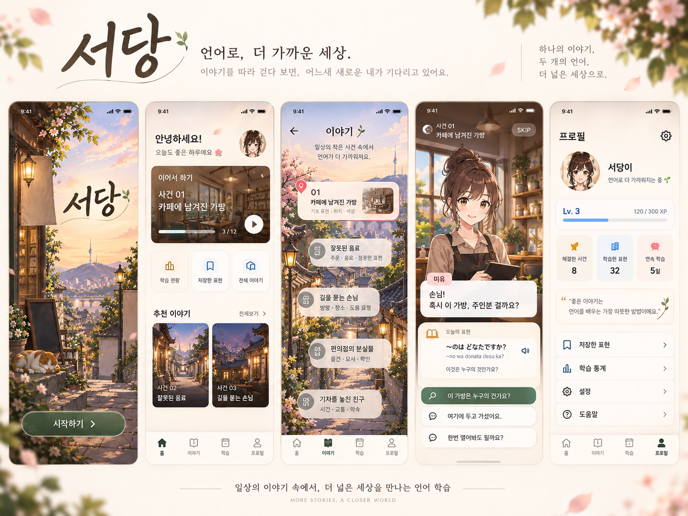

# 서당 — Codex 개발 인계서

작성일: 2026-10-12
문서 버전: 1.0 / 지금까지의 기획·UI·캐릭터·음성 논의 통합
작업 대상: **기존 운영 앱과 분리된, 모바일 우선 웹 프로토타입**

> **언어 학습이 본체다. 사건과 캐릭터는 배운 언어를 실제로 쓰게 만드는 장치다.**
> 세로형 비주얼 노벨과 가벼운 터치 조사를 결합한다. 메인 안내 캐릭터는 ‘서당개’다.
> 로그인 없이 시작하고, 먼저 사건 한 편을 처음부터 끝까지 플레이할 수 있게 만든다.

이 문서는 과거 요청서의 단순 복사본이 아니다. 이후 사용자가 수정한 방향까지 반영한 최신 인계 기준이다. 사용자 확정 요구, 수용된 설계 방향, 구현을 위한 임시 기본값, 미정 사항을 구분한다. 제안한 수치와 기술 구조는 출시 요구나 검증된 최적값이 아니다.

**읽는 순서:** 1~3절에서 범위를 확인하고, 4절의 참고 이미지와 5~7절의 UI·학습 흐름을 본 뒤 구현한다. 서당개와 음성의 준비 상태는 8~9절, 구현·검증 기준은 10~13절에 있다. 문서만으로 착수할 수 있으며, 이전 대화를 추가로 읽는 것이 선행 조건은 아니다.

---

## 1. 지금까지 결정한 방향

### 1.1 사용자 요구와 수용된 방향

| 항목 | 반영할 내용 | 구분 |
| --- | --- | --- |
| 서비스 목적 | 한국어 사용자는 일본어를, 일본어 사용자는 한국어를 배운다. | 확정 |
| 경험의 중심 | 언어를 이해하고 사용하면서 작은 사건을 해결한다. 게임 조작 자체를 목표로 하지 않는다. | 확정 |
| 구현 순서 | 네이티브 앱을 바로 전면 개편하지 않고 웹에서 먼저 경험과 디자인을 검증한다. | 확정 |
| 최종 기기 | 모바일. 웹 시제품도 처음부터 모바일 세로 화면과 터치 기준으로 설계한다. | 확정 |
| 플레이 방식 | 대화·선택 중심 비주얼 노벨 + 필요한 순간의 터치 조사·단서 사용. 자유 이동은 첫 시제품에서 제외한다. | 수용된 방향 |
| 학습 단위 | 사건 한 편을 하나의 학습 에피소드로 본다. | 수용된 방향 |
| 첫 사건 | ‘카페에 남겨진 가방’과 그 안의 대화·조사·노트·해결 흐름은 유지해도 좋다는 사용자 반응을 받았다. | 방향 승인 |
| 로그인 | 로그인·회원가입 UI를 없앤다. 사용자 폰에서 바로 이용하는 경험으로 간다. | 확정 |
| 시작 화면 | 글자를 줄인 두 번째 한옥·노을 골목 이미지를 기준으로 삼는다. 움직이는 시작 화면을 원한다. | 확정 |
| 전체 UI | 선택한 시작 화면을 기존 홈·목록·학습 UI와 연결한 방향을 참고한다. 각 문구·수치까지 확정된 것은 아니다. | 방향 참고 |
| 시각적 취향 | 과하게 AI 시안처럼 보이는 장식과 불필요한 글을 줄인다. | 확정 |
| 메인 캐릭터 | 앱을 안내하는 강아지 ‘서당개’를 메인으로 삼는다. | 확정 |
| 음성 | 기계적인 TTS 느낌이 아니라 자연스러운 사람 목소리를 원한다. 본인 목소리일 필요는 없다. | 확정 |
| 비용·운영 | 생성 크레딧 부족을 고려해, 매번 AI로 생성하는 방식보다 제작한 자산을 재사용하는 방향을 검토한다. | 사용자 제약 + 설계 방향 |

‘서당’은 현재 작업 이름이다. 이름을 변경할 수 있는지 논의했지만 새 이름을 결정하거나 실제로 변경한 것은 아니다. 헤르츠는 중단된 별도 프로젝트이며 이번 작업 대상이 아니다.

### 1.2 착수를 위한 임시 기본값

아래는 제작이 멈추지 않도록 제안하는 기본값이다. 사용자가 모든 항목을 개별 확정한 것으로 해석하지 않는다.

- 첫 완결 데모: **한국어 안내 → 일본어 학습**, 짧은 표현을 쓰는 사건 1편.
- 반대 방향: 구조에서 지원하되, 한국어 학습 콘텐츠를 준비하지 않았다면 활성화하지 않는다.
- 첫 분량: 약 3~5분, 핵심 표현 2~4개를 목표로 하되 속도보다 이해와 완결성을 우선한다.
- 진행 저장: 웹에서는 로컬 저장, 네이티브 적용 때는 기기 내 저장으로 연결할 수 있게 분리한다.
- 제작 방식: 검토 가능한 고정 대사·정답·해설·이미지·음성 파일을 재사용한다.
- 음성 운영: 미리 제작한 파일을 재생하는 구조를 우선 구현한다. 제작 업체·모델 선택은 아직 하지 않는다.

### 1.3 현재 실제로 준비된 것

| 구분 | 현재 상태 |
| --- | --- |
| 기획 | 이전 웹 제작 요청서와 이후 수정 논의가 있다. 이 문서가 이를 통합한다. |
| 화면 | 정적 PNG 시안이 있다. 이 패키지에는 우선 참고할 이미지 6개를 담았다. |
| 플레이 코드 | 이 대화에서 새 프로토타입의 실행 코드나 실행·빌드 검증 결과는 제공되지 않았다. |
| 시작 애니메이션 | 요구만 정리됐다. PNG 자체가 애니메이션인 것은 아니다. |
| 서당개 | 이름과 메인 안내 역할만 정해졌다. 승인된 외형·표정 시트·투명 에셋은 아직 없다. |
| 음성 | 자연스러움이라는 요구와 제작 후보를 논의했다. 확정 성우·음성 파일·학습 모델은 없다. |
| 양방향 교육과정 | 서비스 방향은 유지하지만 두 언어 전체 과정이 제작된 것은 아니다. |

기존 앱의 저장소·구현 상태·기술 스택은 이 대화만으로 단정하지 않는다. 실제 작업 공간을 확인해 재사용 가능 범위를 판단한다.

---

## 2. 이전 문서·시안보다 우선하는 수정 사항

이 절은 과거 자료와 충돌할 때 우선 적용한다.

| 이전 자료에서 오해하기 쉬운 내용 | 지금 적용할 기준 |
| --- | --- |
| PC 브라우저에서 먼저 보기 좋게 만든다. | **모바일 세로 화면을 먼저 설계하고 웹으로 구현한다.** |
| 조작 방식은 완전히 자유롭다. | 기본은 터치·대화·선택이다. WASD, 가상 조이스틱, 카메라 조작을 요구하지 않는다. |
| 첫 화면은 무조건 실제 게임 공간이어야 한다. | 간결한 시작 화면과 홈을 허용한다. 홈은 학습 진입, 사건 안은 스토리 경험에 집중한다. |
| 새로운 세계관·레이아웃을 아무 제약 없이 정한다. | 선택한 한옥·노을 분위기와 전체 UI 연결을 우선 참고한다. 새 디자인 탐색으로 되돌아가지 않는다. |
| 로그인 링크·프로필 사진·회원 닉네임이 있다. | 계정 기능을 만들지 않는다. 개인 화면은 기기 내 학습 기록·설정으로 해석한다. |
| 사람 캐릭터가 앱 전체를 대표한다. | **서당개가 메인 안내 캐릭터다.** 사람 캐릭터는 필요할 때 사건의 등장인물로 남을 수 있다. |
| 시안의 고양이가 메인 마스코트다. | 배경 고양이는 서당개가 아니다. 강아지의 외형을 임의로 승인된 디자인처럼 취급하지 않는다. |
| 첫 화면과 배경 곳곳에 감성 문구를 넣는다. | 시작 화면은 제목·시작 버튼 중심이다. 장식용 한·일·영 문구를 되살리지 않는다. |
| 시안 속 대사·정답·경험치·재화가 명세다. | 이미지는 분위기와 배치 참고다. 학습 내용과 상태는 본문 및 실제 데이터가 기준이다. |
| 사용자의 목소리를 학습시키는 모델이 필수다. | 자연스러움이 우선이다. 성우 녹음이나 다른 목소리도 가능하며 자체 학습은 필수가 아니다. |

---

## 3. 이번 구현의 범위

### 우선 완성할 것

**시작 → 간단한 초기 설정 → 홈 → 사건 01 → 해결·짧은 이해 확인 → 홈·배운 표현 확인**이 끊기지 않아야 한다.

시작 화면, 홈, 이야기 목록, 사건 플레이, 단서 노트, 결과·복습, 로컬 학습 정보·설정을 최소 범위로 삼는다. 단서 노트와 설정은 별도 페이지 대신 패널로 구현해도 된다. 화면 개수 자체를 목표로 하지 않는다.

서당개는 주요 화면에 같은 캐릭터로 일관되게 연결한다. 정식 에셋이 없으면 임시 표시임을 명확히 하고 교체 가능한 컴포넌트로 만든다. 음성이 없더라도 읽기 중심 UI 검증은 진행할 수 있지만, **음성 품질 검증은 완료했다고 보고하지 않는다.**

### 이번에 하지 않을 것

- 기존 네이티브 앱 전면 재개발, 앱스토어 제출, 실제 앱 이름·식별자 변경.
- 운영 DB 변경, 기존 계정·학습 기록 삭제, 운영 자동화·게시 경로 수정.
- 로그인·회원가입·소셜 로그인·원격 계정 프로필.
- 실시간 매칭, 공개 채팅, 협동 참여를 요구하는 진행 조건.
- 자유 이동 RPG, 3D 월드, 전투·장비·유료 재화·복잡한 보상 경제.
- 여러 사건과 두 언어 전체 교육과정을 한꺼번에 제작하기.
- 실시간 LLM/TTS 호출을 플레이의 필수 조건으로 만들기.
- 사용자 음성을 수집하거나 음성 모델을 자동 학습시키기.
- 승인 없는 유료 API 호출, 구독 가입, GPU 대여, 비용 발생 배포.

---

## 4. 참고 이미지와 적용 방법

이미지는 **승인된 최종 앱 에셋이 아니라 정적인 방향 시안**이다. ZIP에는 아래 이름으로 원본 PNG를 복사해 넣었다. 이미지 수정·분리·애니메이션 제작은 이 인계 작업에서 하지 않았다.

| 파일 | 원래 파일명 | 적용할 부분 |
| --- | --- | --- |
| `references/01_start_hanok.png` | `노을빛_한옥_골목_서당의_시작.png` | 선택된 시작 화면. 따뜻한 노을, 한옥 골목, 적은 글자, 초록색 시작 버튼. |
| `references/02_overall_ui_board.png` | `따뜻한_언어_학습_앱_서당_ui_보드.png` | 시작·홈·이야기·플레이·개인 학습 화면의 연결과 분위기. |
| `references/03_case_dialogue.png` | `카페_미스터리와_일본어_학습_ui.png` | 한 사건의 대화와 핵심 표현 제시. |
| `references/04_case_investigation.png` | `카페에_남겨진_가방_단서_찾기.png` | 장면을 눌러 조사하고 단서를 얻는 경험. |
| `references/05_case_notebook.png` | `카페_미스터리_단서_노트_ui.png` | 단서·표현·도움말을 다시 확인하는 구조. |
| `references/06_case_result.png` | `카페_사건_해결_결과_화면.png` | 사건 해결과 학습 표현 확인. |

### 우선 참고할 시안




### 재현할 것과 수정할 것

**재현할 것:** 따뜻한 배경, 크림 계열의 읽기 영역, 차분한 초록색 주요 버튼, 사건이 있는 장소의 분위기, 자연스러운 이야기 진행.

**수정할 것:** 과도한 감성 문구, 반복되는 홍보 문장, 작은 글자, 과한 장식과 반투명 박스, 수치 중심 HUD, 의미 없이 많은 버튼. ‘AI 같은 느낌’의 구체적 해결안으로 이 항목들을 먼저 줄여 본다.

특히 이미지 속 예문·번역·해설·정답을 그대로 옮기지 않는다. 서로 다른 시안에 등장하는 인물 이름, 물건 수, 대사와 단서가 일치하지 않을 수 있다. 사건 01은 7절의 단일 명세를 따른다. 이미지 속 ‘Lv. 3’, ‘120/300 XP’, ‘8개’, ‘32개’, ‘5일’, 보석 수 등은 실제 초기 데이터가 아니다.

### 이미지 전체를 앱 화면으로 쓰지 말 것

- PNG에 이미 글자와 버튼이 합쳐져 있다. 완성 이미지를 통째로 띄우고 투명 클릭 영역만 덮는 방식으로 구현하지 않는다.
- 텍스트·버튼·노트·진행 표시를 실제 UI 요소로 재구현한다. 배경·캐릭터와 분리해 교체할 수 있어야 한다.
- 글자가 없는 배경 원본, 서당개 투명 PNG, 음성 파일은 아직 제공되지 않았다. 누락 자산 목록에 남긴다.
- 임시 배경이나 임시 서당개를 써도 되지만 최종 에셋이라고 보고하지 않는다. 승인 없는 대량 이미지 생성은 하지 않는다.
- 이전의 긴 문구 버전과 일본 마을 시작 화면은 선택되지 않은 대안이므로 이번 패키지에서 제외했다.

---

## 5. 전체 UI와 화면 흐름

기본 구조는 **평소에는 익숙한 학습 앱, 사건에 들어가면 스토리 게임**이다. 복습·설정을 사용하기 위해 가상 공간을 이동하게 만들지 않는다.

```text
시작 화면
  └─ 최초 실행: 제공되는 학습 방향 안내 + 필요한 도움 수준 선택
      └─ 홈
          ├─ 시작하기 / 이어서 하기 → 사건 01
          │    ├─ 도입·표현 학습
          │    ├─ 대화·터치 조사
          │    ├─ 단서 노트·도움말
          │    ├─ 물건 선택·전달·재시도
          │    └─ 해결 → 다른 상황에서 표현 확인 → 홈 / 복습
          ├─ 이야기 목록 → 사건 선택
          ├─ 배운 표현·복습
          └─ 내 학습·설정
```

하단 탭은 `홈 / 이야기 / 복습 / 내 학습`을 임시안으로 제안한다. 기존 보드의 `학습`, `프로필`과 의미가 겹치지 않게 정리한 이름이며 최종 메뉴명이 확정된 것은 아니다. 사건 플레이 중에는 필요 없는 탭을 숨겨 읽기 영역을 확보한다.

### 5.1 시작 화면

선택 이미지의 방향은 유지하되 필수 정보는 **‘서당’ 제목과 ‘시작하기’ 버튼**으로 제한한다. 일본어 안내 버전은 버튼 문구를 해당 안내 언어로 바꿀 수 있다. 로그인 링크, 계정 안내, 영문 슬로건, 배경 간판의 장문 문구는 넣지 않는다.

서당개가 준비되면 골목 앞에서 사용자를 기다리는 식으로 자연스럽게 배치한다. 현재 배경의 고양이를 서당개라고 부르지 않는다. 고양이 유지·제거는 이후 아트 조정 사항이다.

**움직임 요구:** 정지 배경에 작은 움직임을 더하는 방식부터 구현한다. 예를 들어 소수의 꽃잎, 은은한 등불, 서당개의 눈 깜빡임·호흡 중 가능한 것을 선택한다. 이 연출 항목과 속도는 제안이며 모두 필수는 아니다.

제목과 버튼까지 계속 흔들리게 하거나 큰 화면 이동·강제 카메라 패닝을 넣지 않는다. 준비된 PNG 전체를 확대·이동해 버튼이 같이 움직이는 식으로 해결하지 않는다. 애니메이션 종료를 기다리지 않고 즉시 시작할 수 있어야 하며, 모션 감소 설정과 정지 상태를 제공한다.

재방문 때는 초기 설정을 다시 강요하지 않는다. 저장된 상태에 따라 홈의 이어하기로 연결한다. 시작 화면을 매번 보여줄지의 세부 정책은 테스트 후 조정할 수 있다.

### 5.2 최초 진입과 학습 방향

가입이나 개인정보 입력 대신 필요한 학습 설정만 짧게 받는다. 입문자 도움은 `글자부터 도움받기 / 짧은 표현으로 시작하기` 정도의 임시안으로 시작한다. 긴 진단 시험은 만들지 않는다.

첫 데모가 한 방향뿐이면 이 화면에서 `일본어 학습 체험판 · 한국어 안내`처럼 범위를 밝힌다. 시작 배경에 긴 안내를 덧붙이지 않는다. 두 방향 모두 실제로 완결 구현된 뒤에만 양방향 선택을 제공한다.

일본어 안내 UI를 만드는 것과 한국어를 가르치는 콘텐츠를 만드는 것을 혼동하지 않는다. 안내 언어와 학습 언어는 데이터에서 별도로 구분한다.

### 5.3 홈

가장 눈에 띄는 요소는 **현재 할 수 있는 학습과 시작·이어하기 버튼**이다. 큰 사용자 통계나 장문의 인사말보다 우선한다.

- 서당개와 짧은 안내 한 문장.
- 현재 사건 카드: 제목, 실제 진행 상태, 주요 버튼 하나.
- 필요한 경우 짧은 복습 진입점.
- 아래쪽에 이야기 목록으로 가는 보조 진입점.

첫 실행에는 `사건 01 시작하기`, 진행 중에는 `이어서 하기`, 완료 후에는 `표현 다시 보기`처럼 실제 상태에 맞춘다. 출시되지 않은 사건만 있는데 ‘다음 사건’이 활성화되면 안 된다. 기록이 없을 때 경험치·출석·해결 건수를 임의로 채우지 않는다.

### 5.4 이야기 목록

테마가 느껴지는 배경 위에 사건을 고를 수 있게 하되, 실제 이동 월드맵은 필요 없다. 목록 항목을 누르면 시작·이어하기로 연결한다.

사건 01은 플레이 가능하게 만들고, 이후 사건을 보여줄 경우 `준비 중`으로 비활성화한다. ‘잘못 전달된 음료’, ‘길을 묻는 손님’ 등은 후속 아이디어일 뿐 이번에 완성할 콘텐츠가 아니다. 다음 사건의 잠금을 풀었다고 해놓고 비어 있는 화면으로 보내지 않는다.

### 5.5 사건 플레이

상단은 돌아가기·사건 제목·필요한 최소 진행 표시로 구성한다. 중앙에는 장소와 등장인물, 하단에는 읽기 영역과 현재 행동을 배치한다.

입문자 기준으로 사건 배경과 조작 안내는 모국어로 제공하고, 핵심 단서·배울 표현은 학습 언어로 제시한다. 기본 대사 진행과 실제 행동 선택을 구분해 사용자가 지금 읽는 중인지 판단하는 중인지 알 수 있게 한다.

서당개는 안내·힌트·피드백을 담당한다. 카페 직원 같은 사건 인물이 필요한 장면에서는 인물을 그대로 사용할 수 있다. 서당개가 매 문장마다 끼어들거나 학습 문장을 가리지 않게 한다.

### 5.6 단서 노트·도움말

같은 플레이 상태 안에서 열고 닫을 수 있어야 한다. 보유 단서 원문, 배운 표현, 필요한 설명을 확인한다. 번역과 단계별 힌트는 사용자가 요청할 때 펼친다.

획득하지 않은 단서를 미리 보여주거나 힌트 마지막 단계가 기본으로 열려 있지 않게 한다. 힌트를 열었다는 이유로 진행을 막거나 벌점을 주지 않는다. 노트를 닫으면 읽던 대사·선택 상태로 돌아간다.

### 5.7 결과·복습

사건 해결 반응, 사용한 핵심 표현, 맞는 이유, 다른 배치에서의 짧은 확인을 연결한다. 긴 축하 문구·큰 스탬프·여러 통계로 학습 내용을 밀어내지 않는다.

**사건 해결과 표현 숙달을 동일하게 처리하지 않는다.** 한 번 해결한 표현은 ‘이번에 만난 표현’ 또는 ‘복습할 표현’으로 기록하고, 한 번 맞혔다는 이유로 완전 숙달을 표시하지 않는다.

### 5.8 내 학습·설정

기기 내 사건 기록, 복습할 표현, 소리·모션·글자 크기 등 사용 설정을 제공하는 영역이다. 이름·메일·프로필 사진 입력이나 로그아웃은 필요 없다.

기록이 이 기기에 저장된다는 사실을 짧게 안내한다. 시제품에서는 다른 기기와 자동 동기화한다고 약속하지 않는다. 기록 초기화는 명확한 확인 후 이 시제품의 데이터만 지운다.

---

## 6. 모바일 읽기·조작 원칙

아래 치수는 시제품 테스트를 위한 제안값이며 공식 기준 인용이 아니다. 실제 기기에서 확인해 조정한다.

- 세로 폭 360 / 390 / 430px를 먼저 점검한다. PC에서는 같은 세로형 경험을 중앙에 보여도 된다.
- 본문은 대략 16~18 CSS px 이상에서 출발하고, 일본어 학습 표현은 일반 보조 문구보다 크게 다룬다.
- 주요 터치 버튼은 약 44~48 CSS px 높이에서 출발하고 누를 영역 사이에 여유를 둔다.
- 텍스트를 이미지에 굽지 않는다. 문장이 길어지면 읽는 영역을 늘리거나 스크롤하고, 글자를 무작정 축소하지 않는다.
- 학습자가 모를 수 있는 문자·뜻을 다시 확인할 수 있게 한다. 로마자나 번역을 모든 문장 아래 상시 나열하는 것은 기본값으로 삼지 않는다.
- 기본은 탭이다. 물건 전달은 `물건 선택 → 전달하기`로 완료 가능해야 하며 드래그를 필수로 만들지 않는다.
- 조사 가능한 대상과 정답을 구별한다. 모든 조사 대상의 표시 규칙을 같게 하고 정답만 빛내지 않는다.
- 색상·위치만으로 정답을 유추하게 만들지 않는다. 의미를 사용해 판단하되 읽기 보조 기능은 허용한다.
- 사운드 없이도 필요한 내용을 읽을 수 있게 한다. 재생 중인 음성이 읽는 속도를 강제하지 않게 한다.
- 타이핑 효과는 즉시 전체 표시가 가능해야 한다. 같은 탭으로 대사가 표시되자마자 다음 대사까지 건너뛰지 않게 한다.
- 하단 안전 영역과 브라우저 UI로 버튼이 가려지지 않게 한다. 글자 크기를 키웠을 때도 주요 행동이 남아 있어야 한다.
- 키보드·포커스·스크린리더를 위한 의미 있는 버튼·라벨을 사용한다. UI를 하나의 이미지나 캔버스에만 가두지 않는다.

게임성은 이동량이나 버튼 수가 아니라 **이해한 단서 → 내 판단 → 상황의 변화**에서 만든다.

---

## 7. 사건 01 — 카페에 남겨진 가방

### 7.1 한 사건의 의미

한 사건 안에 도입, 필요한 표현 학습, 조사, 판단, 해결, 짧은 이해 확인이 들어간다. 기존 PNG 4개는 별도 사건 4편이 아니라 이 사건 안의 서로 다른 화면이다.

사건의 큰 구조는 사용자에게 유지해도 좋다는 반응을 받았다. 아래 표현·후보 배치·상태 규칙은 기존 요청서를 기준으로 시안 간 불일치를 정리한 구현 명세다. 문장 세부와 음성은 공개 배포 전 언어 검수가 필요하다.

### 7.2 목표와 핵심 표현

손님이 남긴 단서를 읽어 여러 가방 중 주인의 가방을 찾아 전달한다.

| ID | 일본어 학습 표현 | 한국어 의미 | 역할 |
| --- | --- | --- | --- |
| `blue-bag` | あおい かばん | 파란 가방 | 색과 물건 종류 |
| `near-window` | まどの そば | 창문 옆 / 창문 가까이 | 위치 |

필요한 구성 요소는 `あおい`, `かばん`, `まど`, `〜の そば`다. 띄어쓰기는 초급 학습용 구분으로 다루며 자연스러운 표기와 학습용 분절을 데이터·렌더링에서 구분할 수 있게 한다.

완전 입문자는 소수 글자와 표현을 먼저 도움받는다. 이 사건을 마쳤다고 가나 전체를 배운 것으로 표시하지 않는다. 문자 해독, 단어 이해, 문장 이해, 퍼즐 해결을 한 점수로 뭉개지 않는다.

### 7.3 조사 후보와 정답

| 후보 | 색 | 위치 | 판정 |
| --- | --- | --- | --- |
| `bag-window-blue` | 파란색 | 창문 옆 | 두 단서에 모두 맞음 |
| `bag-door-blue` | 파란색 | 문 옆 | 색만 맞음 |
| `bag-window-red` | 빨간색 | 창문 옆 | 위치만 맞음 |

정답은 **색 단서와 위치 단서를 함께** 사용해야 정할 수 있다. 후보의 크기·테두리·반짝임으로 답을 알려주지 않는다. 사진에 가방 수가 다르게 그려져 있어도 구현 후보는 이 명세에 맞춘다.

### 7.4 진행 순서

1. **사건 제시:** 서당개와 직원이 분실물 상황을 설명한다. 아직 정답의 색·위치를 모국어로 대신 알려주지 않는다.
2. **표현 익히기:** 필요한 단어·표현을 짧게 알려주고 뜻을 확인한다. 모르는 글자를 먼저 시험하지 않는다.
3. **단서 조사:** 손님이 남긴 메모의 색 단서와 위치 단서를 확인한다. 얻은 단서를 노트에 기록한다.
4. **판단:** 노트를 다시 보거나 힌트를 요청한 뒤 전달할 가방을 고른다.
5. **행동:** 선택한 가방을 전달한다. 단서 확인 상태와 선택한 물건을 기준으로 판정한다.
6. **피드백:** 오답이면 어느 조건을 다시 봐야 하는지 알려주고 재시도한다. 정답이면 인물 반응과 장면 상태가 바뀐다.
7. **다른 상황 확인:** 창문 위치와 물건 배치를 바꾼 장면에서 `まどの そば`의 의미를 한 번 더 사용한다.
8. **마무리:** 사건 기록과 만난 표현을 저장하고 홈 또는 복습으로 돌아간다.

첫 서당개 안내 문구의 임시 예: “손님이 가방을 두고 갔대. 메모를 같이 읽어볼까?” 말투와 최종 음성 대본은 캐릭터 보이스 확정 전에 바뀔 수 있다.

### 7.5 힌트와 오답 처리

힌트는 `볼 표현 짚기 → 단어 의미 → 전체 의미` 순으로 필요한 만큼 펼친다. 마지막 도움에서 답을 충분히 안내할 수는 있지만 기본 화면에서 모두 노출하지 않는다.

문 옆 파란 가방이면 위치 표현을, 창문 옆 빨간 가방이면 색 표현을 다시 확인하게 한다. 필요한 단서를 아직 확인하지 않았다면 메모 조사로 돌아갈 수 있게 안내한다. 재화를 기다리거나 목숨이 떨어져 학습이 막히는 구조는 넣지 않는다.

다른 상황 확인에서 틀렸더라도 이미 해결한 사건을 취소하지 않는다. 설명·재시도를 제공하고 이해 확인 결과와 사건 완료 상태는 따로 기록한다.

### 7.6 반대 방향으로 확장할 때

일본어 안내로 같은 유형의 사건을 제공하면서 학습 표현을 `파란 가방`, `창문 옆`으로 바꿀 수 있다. 다만 단순 UI 번역만으로 한국어 학습 지원이 완성되는 것은 아니다.

한글을 모르는 단계의 도움, 일본어 해설, 한국어 음성, 문항과 피드백을 별도로 준비해야 한다. 사건 구조는 공유할 수 있어도 난이도·표현 데이터와 오디오를 그대로 뒤집어 쓰지 않는다.

---

## 8. 메인 안내 캐릭터 ‘서당개’

### 8.1 역할

서당개는 장식 아이콘이 아니라 학습을 안내하는 고정 캐릭터다. 시작 화면에서 맞이하고, 홈에서 다음 학습을 알려주며, 사건 안에서는 표현 설명·힌트·오답 재시도·완료 반응을 담당한다.

강아지의 귀여움 때문에 읽기 공간이 줄거나 집중이 끊기면 안 된다. 매 화면을 서당개의 긴 대사로 채우지 않는다. 사람 NPC를 모두 없애는 것은 현재 요구가 아니다.

### 8.2 아직 정해지지 않은 것

견종, 털색, 옷·소품, 성별 설정, 정확한 비율, 말투와 성격, 공식 목소리는 확정하지 않았다. 반복 이미지에서 외형이 조금씩 달라지는 문제를 막기 위해 기본 디자인 하나를 확인한 뒤 나머지 자산을 확장한다.

현재 PNG의 고양이·카페 직원·프로필 인물 중 누구도 서당개의 승인된 원형이 아니다. 디자인이 없다는 이유로 화면마다 다른 강아지 이미지를 쓰지 않는다.

### 8.3 첫 에셋 세트 제안

초기에는 기본 대기, 설명·가리키기, 듣기, 생각·힌트, 격려, 축하의 6개 상태와 작은 얼굴 아이콘 정도를 목표로 한다. 이는 제안 범위이며 앞선 대화의 표정·포즈 수량이 발주 확정된 것은 아니다.

투명 배경, 같은 캔버스·기준점·비율을 사용한다. 눈 깜빡임이나 입 모양은 필요한 경우 소수 프레임 또는 분리 레이어로 추가한다. 앞·옆·뒤 시트와 더 많은 포즈는 첫 플레이 검증 후 확장해도 된다.

예시 슬롯:

```text
assets/mascot/seodang-dog/
  idle.png
  explain.png
  listen.png
  think.png
  encourage.png
  celebrate.png
  avatar.png
```

**위 파일은 앞으로 필요한 경로 예시이며, 이번 패키지에 존재하지 않는다.** 에셋이 없으면 명시적인 임시 상태로 구현하고 누락 목록을 남긴다. 플레이 중 새 캐릭터 이미지를 생성하지 않는다.

---

## 9. 음성 — 자연스러움 우선, 제작 방식은 미정

### 9.1 사용자 요구

기계적인 TTS 목소리가 싫고, 학습 앱에서 자연스러운 사람 목소리를 듣고 싶다는 요구다. 처음에는 본인 음성 학습을 질문했지만 이후 **본인 목소리가 아니어도 된다**고 명확히 했다.

따라서 자체 음성 모델, 보이스 클론, 한국어·일본어 각 수십 분 녹음을 필수 작업으로 잡지 않는다. ‘음성을 넣기만 하면 된다’거나 기본 기기 TTS를 연결하면 요구가 충족된다고 판단하지 않는다.

### 9.2 앞서 논의한 후보 — 선택된 서비스가 아님

| 후보 | 이 프로젝트에서 검토한 사용법 | 지금 하지 말 것 |
| --- | --- | --- |
| 자연스러운 합성음성 서비스 | 기존 목소리로 대사를 미리 제작해 파일로 사용. ElevenLabs가 후보로 언급됨. | 결제·API 연결·특정 목소리 확정으로 간주하지 않기. |
| 로컬 음성 모델 | 개발용 컴퓨터에서 미리 파일을 제작. Qwen3-TTS가 후보로 언급됨. | 사용자 기기에 모델을 탑재하거나 사양 확인 없이 GPU 설치·대여하지 않기. |
| 사람 녹음 | 한·일 화자에게 공통 안내와 첫 사건의 핵심 표현부터 소량 녹음 의뢰. | 앱 전체 더빙이나 성우 계약을 승인 없이 진행하지 않기. |

이 목록은 이전 대화의 선택지를 보존한 것이다. 최신 가격·무료 분량·라이선스·언어 품질·하드웨어 요구를 이 문서에서 보증하지 않는다. 실제 채택 전에 해당 시점의 공식 조건과 음성 사용 권리를 확인한다.

### 9.3 권장 구현 구조 — 교체 가능하게 먼저 만들기

```text
대사와 학습 문장 확정
  → 사람 녹음 또는 사전 음성 생성
  → 발음·말투·텍스트 일치 검수
  → 문장별 오디오 파일로 보관
  → 콘텐츠 ID와 연결
  → 앱에서는 재생
```

제작 비용과 앱의 재생 흐름을 분리한다. 이번 프로토타입은 음성 생성 서버·API 키 없이 작동하도록 한다. 고정 파일의 배포·캐싱과 과금 정책은 추후 선택 사항이며 완전 오프라인 지원을 자동으로 보장하지 않는다.

서당개의 공통 안내 음성과 **학습 대상 언어의 발음 음성**을 구분한다. 예를 들어 한국어 안내·일본어 학습에서는 가이드 설명은 한국어, `あおい かばん` 발음은 일본어다. 반대 방향에서는 역할이 바뀐다.

한·일 목소리가 완전히 같은 음색일 필요는 없다. 안내는 자연스럽게, 학습 표현은 자연스럽고 또렷하게 들리는지를 우선 검토한다. 억지로 높은 강아지 목소리를 만드는 것은 확정 요구가 아니다.

### 9.4 파일 연결과 누락 처리

```json
{
  "id": "case01.near-window.ja",
  "locale": "ja-JP",
  "role": "learning",
  "text": "まどのそば",
  "audioFile": null,
  "status": "missing"
}
```

이는 매니페스트 형태의 예시다. 실제 음성 파일이 없는 현재 상태를 `null`과 `missing`으로 표현한다. 파일이 준비되면 경로와 검수 상태를 채운다. `audioFile`, 제작 방법, 사용 권리 확인, 언어 검수 여부를 추적할 수 있게 한다.

음성이 없으면 듣기 버튼을 숨기거나 준비 중임을 분명히 한다. 눌러도 아무 반응 없는 버튼이나 기본 TTS로 몰래 대체하는 흐름은 금지한다. 사용자가 요청한 재생 실패는 짧게 알리고 텍스트로 계속 진행할 수 있게 한다. 대사 전환·다른 음성 재생 때 중첩되지 않게 한다.

### 9.5 음성 채택 전 확인할 것

첫 사건의 실제 대사로 자연스러움, 목표 언어 발음·억양, 학습 문장과의 일치, 문장 길이에 따른 품질, 여러 번 들어도 거슬리지 않는지를 확인한다. 교육용 음성은 해당 언어에 능숙한 검수자의 확인을 받는 방향으로 준비한다.

합성 느낌이 계속 불만족스럽다면 사람 녹음으로 전환하는 후보가 남아 있다. 단순히 새 엔진을 연결했다는 이유로 ‘사람처럼 자연스럽다’고 완료 판정하지 않는다.

---

## 10. 구현과 데이터 구조 제안

### 10.1 기술 선택

실제 작업 공간을 먼저 확인한다. 기존 웹 실험 환경이 있으면 활용하고, 없다면 독립된 React + TypeScript 웹 프로젝트를 우선 후보로 삼는다. 이는 사용자 기술 환경에 맞춘 제안이지 기존 서당 앱이 해당 스택이라는 주장이나 특정 프레임워크 강제는 아니다.

이번 범위 때문에 무거운 게임 엔진, 음성 모델 서버, 계정 서버를 새로 붙이지 않는다. 사용 가능한 패키지·실행 명령은 저장소를 보고 결정한다. 기존 앱 전체 분석이나 이전 작업을 삭제하는 리팩터링을 착수 조건으로 만들지 않는다.

### 10.2 분리할 책임

| 영역 | 책임 |
| --- | --- |
| 화면 | 홈, 사건 선택, 플레이, 노트, 결과, 학습 정보 |
| 사건 데이터 | 대사, 표현, 조사 대상, 정답 조건, 힌트, 피드백 |
| 진행 엔진 | 현재 단계, 단서 획득, 가방 선택, 해결, 재시도 |
| 학습 기록 | 만난 표현, 이해 확인 결과, 도움 사용 기록 |
| 로컬 저장 | 저장·복원·버전 구분·초기화 |
| 캐릭터 | 서당개 상태와 에셋 매핑 |
| 오디오 | 문장 ID와 파일 연결, 재생·정지·오류 처리 |

새 사건을 추가할 때 화면 코드를 통째로 복사하지 않도록 내용과 UI를 분리한다. 다만 범용 스토리 엔진이나 콘텐츠 관리 시스템부터 크게 만들지 않는다.

### 10.3 로컬 상태 예시

```json
{
  "schemaVersion": 1,
  "courseDirection": "ko-ja",
  "onboardingComplete": false,
  "supportMode": "beginner",
  "settings": {
    "soundEnabled": true,
    "motionPreference": "system",
    "textScale": 1
  },
  "episodes": {
    "case-01": {
      "contentVersion": 1,
      "status": "not_started",
      "stepId": null,
      "collectedClueIds": [],
      "selectedObjectId": null,
      "hintLevelsUsed": {},
      "attemptCount": 0,
      "solved": false,
      "transferCheck": "not_attempted"
    }
  },
  "encounteredExpressionIds": []
}
```

이 구조는 구현 예시다. 서버 사용자 ID·메일·로그인 토큰은 필요 없다. `ko-ja`와 `ja-ko`는 학습 방향 구분이며 반대 방향 기록과 콘텐츠가 섞이지 않게 한다.

웹 저장은 시제품 전용 키로 격리한다. 새로고침·닫았다 다시 열기·홈으로 나가기 후 이어할 수 있게 한다. 저장 실패 때는 현재 세션을 유지하면서 상태를 알리고, 기존 기록을 말없이 덮어쓰지 않는다. 스키마나 콘텐츠 버전이 달라졌을 때도 기록을 무조건 삭제하지 않는다.

`localStorage.clear()`처럼 같은 출처의 다른 앱 데이터까지 지우는 방식은 사용하지 않는다. 기기 내 저장은 계정 기반 복원이나 자동 동기화를 의미하지 않는다. 웹 시제품과 추후 네이티브 앱 사이의 기록 자동 이전도 이번 범위가 아니다.

### 10.4 사건 상태와 예외

```text
not_started
  → intro
  → expression_support
  → investigate
  → choose_and_submit
       ├─ 단서 부족 → investigate
       ├─ 조건 불일치 → feedback → investigate 또는 choose_and_submit
       └─ 조건 일치 → solved
  → transfer_check
  → summary
```

노트·도움말·설정은 진행을 잃지 않고 열리는 보조 상태로 다룬다. 빠른 연속 탭으로 대사가 여러 번 넘어가거나, 완료·보상이 중복 반영되지 않게 한다. 재시작은 해당 사건 상태를 대상으로 하며 전체 기록 초기화와 구분한다.

---

## 11. 권장 제작 순서

1. **작업 공간 확인:** 실행 방법과 기존 구조를 확인하고 운영 기능과 분리된 시제품 범위를 잡는다.
2. **모바일 기본 화면 연결:** 시작, 홈, 사건 목록, 플레이, 결과의 세로형 흐름을 실제 버튼으로 연결한다.
3. **사건 01 완결:** 대사·표현 학습·조사·판정·오답·힌트·다른 상황 확인을 고정 데이터로 완성한다.
4. **서당개와 시각 정리:** 같은 안내 컴포넌트를 주요 화면에 연결한다. 에셋 미완료는 교체 지점과 함께 명시한다. 간단한 시작 움직임을 넣는다.
5. **저장·복습·음성 슬롯:** 진행 복원, 표현 기록, 설정, 오디오 매니페스트·재생·누락 상태를 연결한다.
6. **실제 동작 점검:** 작은 화면, 긴 문장, 오답, 힌트, 재방문, 저장 실패, 음성 누락·재생 오류를 확인한다.

기획 설명·대형 랜딩 페이지·디자인 보드만 만들어 끝내지 않는다. 동시에 서당개 정식 디자인이나 음성 계약이 끝날 때까지 화면·사건 개발을 전부 멈출 필요도 없다. 시제품 동작 완료와 미디어 자산·음성 품질 완료를 별도로 보고한다.

---

## 12. 완료 기준과 테스트

### 12.1 플레이 가능한 시제품 완료 기준

- [ ] 로그인·회원가입 없이 시작하고 초기 설정을 마칠 수 있다.
- [ ] 선택된 한옥·노을 시작 화면의 방향과 최소 문구를 반영했다.
- [ ] 시작 화면에 실제 움직임이 있으며 즉시 진입·정지 상태·모션 감소를 고려했다.
- [ ] 홈에서 새 학습과 이어하기가 실제 기록에 맞게 표시된다.
- [ ] 서당개가 메인 안내 역할로 연결되며, 임시 에셋 사용 여부가 명시돼 있다.
- [ ] WASD·조이스틱·자유 이동·필수 드래그 없이 전체 플레이가 가능하다.
- [ ] 사건 01이 표현 학습부터 조사·판단·해결·이해 확인까지 이어진다.
- [ ] 색과 위치 두 단서가 판정에 필요하며 정답만 시각적으로 강조되지 않는다.
- [ ] 단서 부족·오답·힌트 사용 뒤에도 다시 시도하고 완료할 수 있다.
- [ ] 노트·설정을 열고 닫아도 읽던 위치와 사건 상태가 유지된다.
- [ ] 다른 배치에서 같은 표현을 확인하는 단계가 있다.
- [ ] 사건 완료와 표현 숙달을 동일하게 처리하지 않는다.
- [ ] 홈으로 나가기·새로고침·재접속 후 저장된 진행을 복원한다.
- [ ] 초기화가 시제품 또는 해당 사건 범위에만 작동한다.
- [ ] 실제 다른 이용자·외부 생성 API·운영 DB 없이 사건을 완료할 수 있다.
- [ ] 미구현 언어·후속 사건·없는 음성을 정상 작동하는 기능처럼 보여주지 않는다.
- [ ] 글자·버튼이 실제 UI로 구현됐고 작은 화면·확대 글자에서도 읽기와 조작이 유지된다.

### 12.2 별도로 남겨야 할 검증

- [ ] 서당개 최종 외형·표정·말투 승인.
- [ ] 필요한 배경·투명 캐릭터·분리 에셋 확보와 사용 범위 확인.
- [ ] 실제 한국어·일본어 음성 샘플의 자연스러움 평가.
- [ ] 학습용 문장·발음·해설 검수와 음성 사용 권리 확인.
- [ ] 반대 학습 방향의 완결 콘텐츠·입문 도움 검증.
- [ ] 게임에 익숙하지 않은 초급 학습자의 실제 휴대폰 사용 관찰.

위 항목이 남아 있다면 ‘UI 동작 시제품 완료, 음성 품질·최종 아트 미검증’처럼 나눠 보고한다. PNG가 예쁘게 보이거나 사건을 끝냈다는 이유만으로 학습 효과·재방문 의향까지 검증됐다고 하지 않는다.

### 12.3 테스트에서 볼 질문

**조작:** 설명 없이도 다음 행동을 아는가? 막힌 이유가 외국어인지 UI인지 구별되는가?

**학습:** 도움을 본 뒤 새로운 배치에서도 표현을 이해하는가? 버튼 위치를 기억해서 통과한 것은 아닌가?

**재미:** 이야기의 다음 단서나 다음 사건을 자발적으로 보고 싶어 하는가? 대사만 넘기는 지점은 어디인가?

**음성:** 자연스럽게 들리면서도 따라 배울 수 있는 발음인가? 안내 음색과 학습 음성의 역할이 맞는가?

---

## 13. 미정 사항과 작업을 멈춰야 하는 경우

| 항목 | 현재 상태 | 진행 원칙 |
| --- | --- | --- |
| 서당개 외형 | 미정 | 교체 가능한 임시 슬롯으로 진행. 최종 자산 확장은 기본 디자인 확인 후. |
| 서당개 말투·공식 목소리 | 미정 | 짧고 부담 없는 임시 문구 사용. 최종 녹음 전에 확인. |
| 음성 제작 서비스·성우 | 미정 | 파일 재생 구조만 먼저 구현. 유료 작업은 별도 승인. |
| 시작 화면 세부 움직임 | 움직임 요구만 확정 | 가벼운 효과 하나부터 구현하고 실제 화면에서 검토. |
| 첫 데모 언어 | 한국어 안내→일본어 학습이 임시 기본값 | 먼저 한 방향을 완결. 양방향 동시 제작은 강제하지 않음. |
| 메뉴 이름·보상 체계 | 최종 미정 | 최소 기능 위주. XP·보석·호감도 경제를 임의로 도입하지 않음. |
| 저장 기술·추후 네이티브 통합 | 미정 | 로컬 저장 인터페이스 분리. 운영 기록 이전은 이번 범위 밖. |
| 최종 브랜드명 | 변경 가능성만 논의 | 작업 이름 ‘서당’ 유지. 실제 스토어 변경 금지. |

소소한 레이아웃·구현 선택은 이유를 짧게 기록하고 진행한다. 유료 서비스·실제 사용자 데이터·운영 배포·음성 권리·추가 개인정보 수집이 필요한 판단은 임의로 하지 않는다.

---

## 14. Codex 완료 보고에 포함할 내용

변경한 파일, 실행 명령, 구현한 화면과 실제 연결된 흐름, 테스트한 기기·화면 크기, 정상·오답·힌트·저장 복원 확인 결과를 보고한다. 실행하지 못한 테스트를 성공했다고 적지 않는다.

서당개 임시 에셋, 배경 분리 필요, 음성 없음, 반대 언어 미구현 같은 미완료 사항은 별도 목록으로 남긴다. 미리보기 주소는 실제 생성된 주소가 있을 때만 제공한다. 남은 작업을 설명하는 것과 실행 가능한 시제품을 제공하는 것을 구분한다.

**최종 판단 기준:** “게임처럼 보이는 화면이 만들어졌는가?”가 아니라 “초보자가 휴대폰에서 언어를 이해해 사건 한 편을 해결할 수 있는가?”다.

---

## 15. 이 문서와 함께 전달할 첫 메시지

> 첨부한 `SEODANG_CODEX_HANDOFF.md`를 최신 기준으로 읽고, 함께 있는 `references/` 이미지들을 참고해서 실제로 플레이할 수 있는 모바일 우선 웹 프로토타입을 만들어 줘.
>
> 언어 학습이 중심이고, 세로형 비주얼 노벨 + 터치 조사 방식이야. 로그인은 없애고, 서당개를 메인 안내 캐릭터로 연결해 줘. 첫 사건은 ‘카페에 남겨진 가방’ 한 편을 끝까지 구현해 줘. 시작 화면은 선택한 한옥·노을 이미지처럼 글자를 적게 두고 가볍게 움직이게 해 줘.
>
> 기존 시안의 문구·가짜 통계·로그인·사람 중심 메인 캐릭터를 그대로 복사하지 마. 서당개와 음성은 최종 자산이 아직 없으니 교체 가능한 구조와 누락 상태를 만들어 줘. 음성은 실시간 생성 API 대신 미리 제작한 파일을 재생할 수 있도록 하되, 없는 음성을 기본 TTS로 몰래 대체하지 마.
>
> 기획안이나 소개 페이지로 끝내지 말고 구현하고 테스트해 줘. 임시 기본값으로 진행하되, 운영 중인 앱·DB·기존 데이터·자동화는 건드리지 말고 유료 서비스도 승인 없이 연결하지 마. 실제로 구현한 것과 최종 아트·음성 등 남은 것을 구분해서 보고해 줘.

---

## 16. 자료의 기준과 패키지 구성

기준 자료는 현재 대화의 사용자 요구와 수정 사항, 사용자가 검토한 UI PNG, 이전 `seodang_web_game_prototype_brief.md`의 학습·상태 처리·운영 보호 원칙이다. 이전 문서의 PC 우선·조작 자유 등 충돌하는 부분은 이 인계서 2절의 수정으로 대체했다.

이 인계 작업은 기존 이미지를 수정하거나 새로운 이미지·음성·실행 앱을 만든 작업이 아니다. 과거 자료의 내용을 정리하고 참고 PNG를 원본 그대로 복사했다. 세부 가격·정책·모델 성능을 새로 조사한 문서도 아니다.

```text
seodang_codex_handoff/
  SEODANG_CODEX_HANDOFF.md
  ASSET_MANIFEST.json
  references/
    01_start_hanok.png
    02_overall_ui_board.png
    03_case_dialogue.png
    04_case_investigation.png
    05_case_notebook.png
    06_case_result.png
```

`ASSET_MANIFEST.json`에는 원래 파일명, 크기, 용도, 체크섬을 기록했다. 폰트 파일·비밀 키·사용자 음성·운영 데이터는 포함하지 않는다. Markdown 단독으로도 요구와 구현 범위를 이해할 수 있고, 이미지까지 참고하려면 ZIP을 풀어 위 구조를 함께 전달하면 된다.
